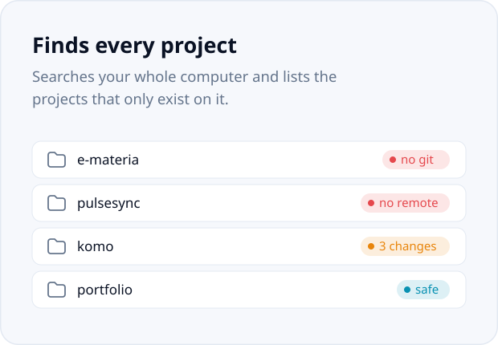
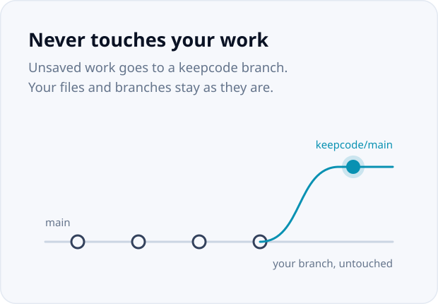
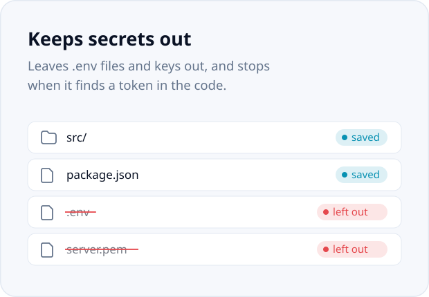
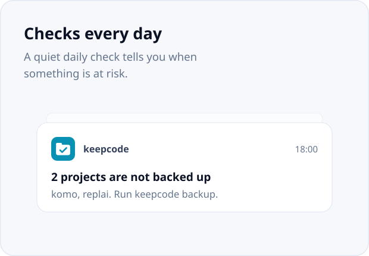
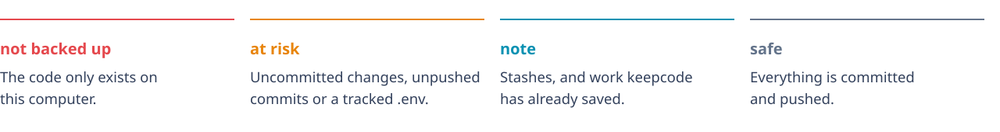
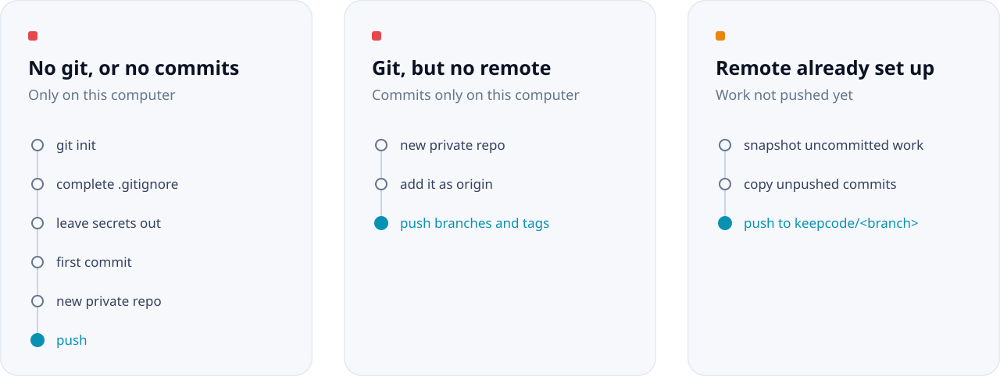

<div align="center">

<picture>
  <source media="(prefers-color-scheme: dark)" srcset="docs/assets/hero-dark.svg">
  
</picture>

<br/><br/>

<a href="#install"><picture><source media="(prefers-color-scheme: dark)" srcset="docs/assets/btn-install-dark.svg"></picture></a>
<a href="#how-it-works"><picture><source media="(prefers-color-scheme: dark)" srcset="docs/assets/btn-how-dark.svg"></picture></a>
<a href="#commands"><picture><source media="(prefers-color-scheme: dark)" srcset="docs/assets/btn-commands-dark.svg"></picture></a>
<a href="https://github.com/masterrr3470/keepcode/issues/new"><picture><source media="(prefers-color-scheme: dark)" srcset="docs/assets/btn-help-dark.svg"></picture></a>

<br/><br/>

<a href="https://github.com/masterrr3470/keepcode/actions/workflows/ci.yml"></a>

<a href="LICENSE"></a>

</div>

<br/>

## Why

Code rarely gets lost in a dramatic way. It is a project that never left the Downloads folder, a repository with no remote, a week of work nobody committed. keepcode checks every project on your computer at once and backs up what is at risk to GitHub, without touching your files or your branches.

<p align="center">
  <picture><source media="(prefers-color-scheme: dark)" srcset="docs/assets/feat-find-dark.svg"></picture>
  <picture><source media="(prefers-color-scheme: dark)" srcset="docs/assets/feat-safe-dark.svg"></picture>
</p>
<p align="center">
  <picture><source media="(prefers-color-scheme: dark)" srcset="docs/assets/feat-secrets-dark.svg"></picture>
  <picture><source media="(prefers-color-scheme: dark)" srcset="docs/assets/feat-daily-dark.svg"></picture>
</p>

## Install

```bash
pipx install git+https://github.com/masterrr3470/keepcode
```

keepcode needs Python 3.10 or newer and [Git](https://git-scm.com/downloads). `pip install` works too, but [pipx](https://pipx.pypa.io) keeps keepcode in its own environment.

## Quick start

```bash
keepcode                  # see which projects are at risk
keepcode login            # once, so keepcode can create private repositories
keepcode backup           # choose projects and back them up
keepcode schedule on      # check every day at 18:00
```

## What keepcode finds

<picture>
  <source media="(prefers-color-scheme: dark)" srcset="docs/assets/statuses-dark.svg">
  
</picture>

keepcode searches your home folder seven levels deep and skips dependencies, build output, system folders and hidden folders. A monorepo counts as one project.

<details>
<summary><b>Which folders count as a project</b></summary>
<br>

A folder with a `.git` folder, or with a typical project file such as `package.json`, `pyproject.toml`, `requirements.txt`, `manage.py`, `Cargo.toml`, `go.mod`, `pom.xml`, `build.gradle`, `composer.json`, `Gemfile`, `pubspec.yaml`, `CMakeLists.txt`, `platformio.ini`, `project.godot`, `.sln`, `.csproj` or `.ino`. A Unity project and an `index.html` next to its styles and scripts also count.

</details>

## How it works

<picture>
  <source media="(prefers-color-scheme: dark)" srcset="docs/assets/flow-dark.svg">
  
</picture>

keepcode always shows its plan and asks before changing anything, and `--dry-run` only shows the plan. On a remote you already use it never pushes your real branches, so nothing gets deployed by accident. Snapshots are built in a temporary staging area with `git commit-tree`, so your files, your staging area and your current branch stay exactly as they were.

To get a snapshot back:

```bash
git fetch origin
git switch -c recovered origin/keepcode/main
```

**keepcode never:**

* pushes to your existing branches on a remote you already use;
* force-pushes anything except its own `keepcode/*` branches;
* changes your files, except adding missing lines to `.gitignore` when it creates the first commit;
* writes your GitHub token to `.git/config` or the command line;
* runs your git hooks.

## Commands

| Command | What it does |
| --- | --- |
| `keepcode scan` | List the projects at risk (plain `keepcode` does the same). `--all` also lists safe ones, `--json` prints JSON. |
| `keepcode backup` | Choose projects and back them up. Pass folders to skip the choice. `--dry-run` only shows the plan. |
| `keepcode check` | Scan and exit with code 1 when something is at risk. `--notify` shows a notification. |
| `keepcode login` | Save a GitHub token in the system keychain. `logout` removes it. |
| `keepcode schedule on` | Check every day. `--time 18:00` sets the time, `off` stops it. |
| `keepcode roots` | Choose the folders keepcode searches: `list`, `add`, `remove`, `reset`. |
| `keepcode ignore` | Choose folders keepcode skips: `list`, `add`, `remove`. |
| `keepcode config` | Change the search `--depth` and turn `--auto-backup` on or off. |
| `keepcode doctor` | Check git, the token, the folders and the schedule. |

<details>
<summary><b>Secrets</b></summary>
<br>

Before anything is committed or pushed, keepcode checks the files.

* `.env` files (but not `.env.example`), private keys, keystores and service account files are left out, and added to `.gitignore` when keepcode creates the repository.
* Tokens written in the code stop the backup. keepcode recognizes GitHub, GitLab, AWS, Google (including Gemini), OpenAI, Anthropic, Stripe, Slack, SendGrid, npm, PyPI, Telegram and Discord tokens, private keys and Supabase `service_role` keys. The public Supabase `anon` key is not reported.

When a secret is found, move it to a `.env` file, add `keepcode:allow` to the line if it is a false positive, or run `keepcode backup --allow-secrets`. Secret files are never backed up: keep them in a password manager.

</details>

<details>
<summary><b>GitHub token</b></summary>
<br>

keepcode only needs a token to create new repositories, and they are always private. It looks for one in this order:

1. the `KEEPCODE_GITHUB_TOKEN`, `GITHUB_TOKEN` or `GH_TOKEN` environment variables;
2. the [GitHub CLI](https://cli.github.com), if you are logged in;
3. the token saved with `keepcode login`, kept in Windows Credential Manager, macOS Keychain or Secret Service on Linux.

The simplest option is a classic token with the `repo` scope: [create one here](https://github.com/settings/tokens/new?scopes=repo&description=keepcode). A fine-grained token works if it can access all repositories with **Administration** and **Contents** set to read and write.

</details>

<details>
<summary><b>Daily check</b></summary>
<br>

`keepcode schedule on` runs a check once a day and shows a notification when a project is at risk. On Windows it uses the Task Scheduler, needs no administrator rights and never opens a window. On macOS and Linux it uses your crontab.

The check only warns you. With `keepcode config --auto-backup` it also saves uncommitted and unpushed work to `keepcode/*` branches for projects that already have a remote. It never creates repositories on its own.

</details>

<details>
<summary><b>Limitations</b></summary>
<br>

* New repositories are created on GitHub only. Existing remotes on any host work for `keepcode/*` branches.
* Stashes are reported but not backed up.
* Files over 95 MB are left out, because GitHub rejects files over 100 MB. Git LFS is not handled.
* Hidden folders are not searched. Add them with `keepcode roots add`.
* On Linux, notifications from cron depend on your desktop session.

</details>

<details>
<summary><b>Development</b></summary>
<br>

```bash
git clone https://github.com/masterrr3470/keepcode
cd keepcode
python -m venv .venv
source .venv/bin/activate        # Windows: .venv\Scripts\activate
pip install -e ".[dev]"
pytest
```

The tests create real repositories and local remotes in temporary folders, so they never touch GitHub. They run on Windows and Linux on every push.

</details>

<br>

<picture>
  <source media="(prefers-color-scheme: dark)" srcset="docs/assets/footer-dark.svg">
  
</picture>
