  

 

## About me

I'm a software development student at Escola Profissional de Gaia, in Portugal, and I like building complete products, from the database to the last animation. Most of my work is APIs in Django REST Framework with interfaces in React and TypeScript, and lately a lot of apps with AI at the core. I also enjoy mixing software with hardware, from ESP32 devices to desktop apps with Tauri.

**Right now**

- Building [keepcode](https://github.com/masterrr3470/keepcode), an open source tool that finds every project on your computer that is not backed up and fixes it with one command
- Looking for an internship in Porto or Gaia (on site or hybrid)

 

## Tech stack

<table>
<tr>
<td width="140"><b>Backend</b></td>
<td></td>
</tr>
<tr>
<td><b>Frontend</b></td>
<td></td>
</tr>
<tr>
<td><b>Tools and more</b></td>
<td></td>
</tr>
</table>

 

## Featured projects

 

## GitHub activity

  

 

