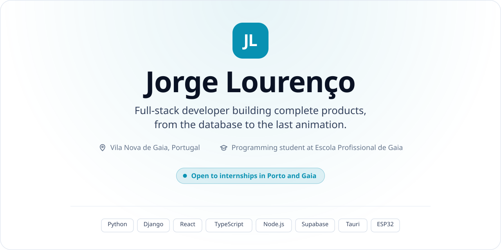
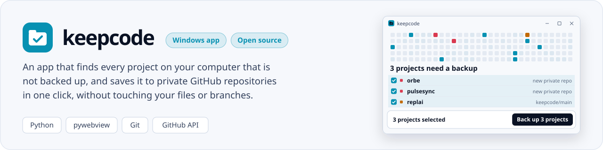
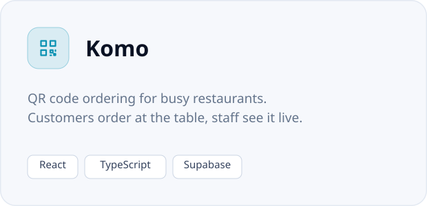
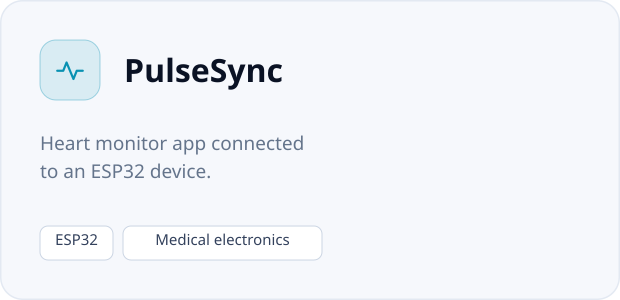
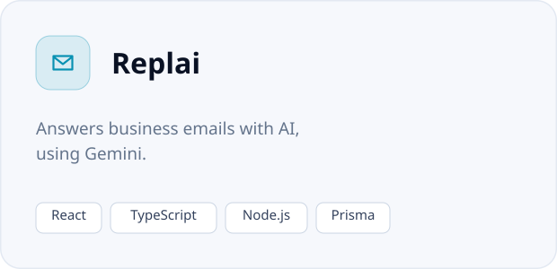
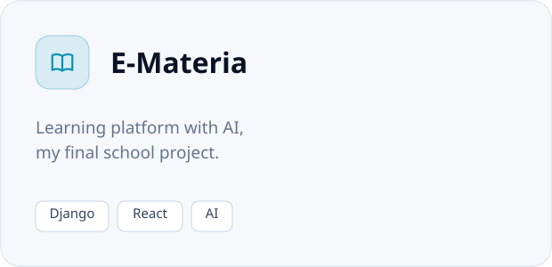
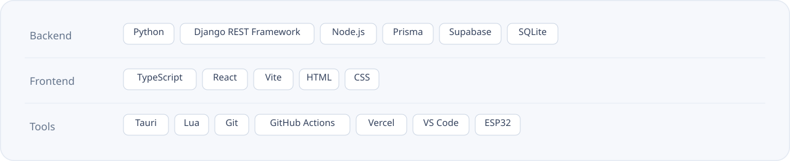

<picture>
  <source media="(prefers-color-scheme: dark)" srcset="assets/hero-dark.svg">
  
</picture>

  

<a href="https://jorge-lourenco.vercel.app/"><picture><source media="(prefers-color-scheme: dark)" srcset="assets/btn-portfolio-dark.svg"></picture></a>
<a href="mailto:lourencojorge428@gmail.com"><picture><source media="(prefers-color-scheme: dark)" srcset="assets/btn-email-dark.svg"></picture></a>
<a href="https://github.com/masterrr3470/keepcode"><picture><source media="(prefers-color-scheme: dark)" srcset="assets/btn-keepcode-dark.svg"></picture></a>

 

## About me

I'm a full-stack developer and programming student at Escola Profissional de Gaia, in Portugal. Most of my work is APIs in Django REST Framework with interfaces in React and TypeScript, and lately a lot of apps with AI at the core. I also like mixing software with hardware, from ESP32 devices to desktop apps with Tauri.

My latest project is keepcode, a Windows app that backs up every project on your computer to GitHub in one click. I'm looking for an internship in Porto or Gaia, on site or hybrid.

## Featured

<a href="https://github.com/masterrr3470/keepcode"><picture><source media="(prefers-color-scheme: dark)" srcset="assets/featured-keepcode-dark.svg"></picture></a>

keepcode started as a command line tool and is now an app. Double-click it and a grid of squares lights up while it searches your computer, one square per project, coloured by how safe it is. It lists what is not backed up and why, and one button sends each project to its own private GitHub repository. It also updates itself from GitHub Releases. Built with Python, a [pywebview](https://pywebview.flowrl.com) window and GitHub Actions.

## Projects

  <a href="https://jorge-lourenco.vercel.app/"><picture><source media="(prefers-color-scheme: dark)" srcset="assets/project-komo-dark.svg"></picture></a>
  <a href="https://jorge-lourenco.vercel.app/"><picture><source media="(prefers-color-scheme: dark)" srcset="assets/project-pulsesync-dark.svg"></picture></a>

  <a href="https://jorge-lourenco.vercel.app/"><picture><source media="(prefers-color-scheme: dark)" srcset="assets/project-replai-dark.svg"></picture></a>
  <a href="https://jorge-lourenco.vercel.app/"><picture><source media="(prefers-color-scheme: dark)" srcset="assets/project-e-materia-dark.svg"></picture></a>

You can try an interactive demo of each one on my [portfolio](https://jorge-lourenco.vercel.app/).

## Tech stack

<picture>
  <source media="(prefers-color-scheme: dark)" srcset="assets/stack-dark.svg">
  
</picture>

## GitHub activity

  

 

<picture>
  <source media="(prefers-color-scheme: dark)" srcset="assets/footer-dark.svg">
  
</picture>
